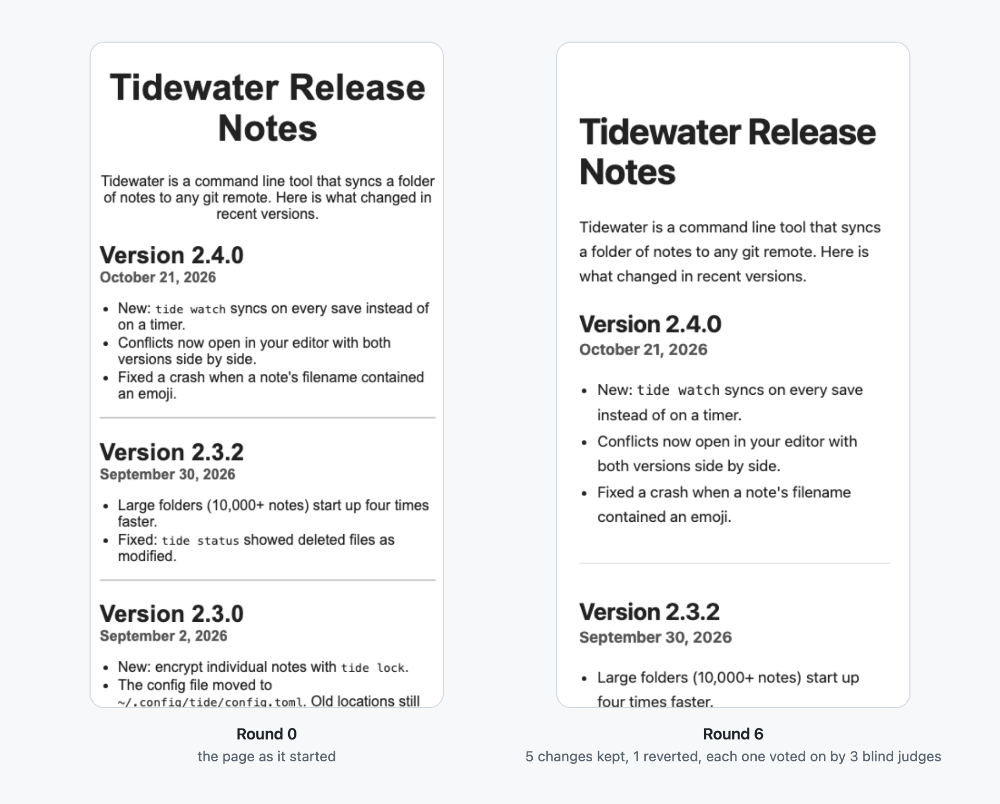

# hill-climb

**Hand your coding agent something to improve, and get back a better version plus a log that proves each step.**

hill-climb is an agent skill. It makes the agent work in rounds: change one thing, score it against the
current best, keep it only if it wins, revert it if not, and write every round down. It works when the score
is a number (runtime, bundle size, loss, latency) and when it is a matter of taste (how a page looks), where
blind judges vote instead.

<picture>
  <source media="(prefers-color-scheme: dark)" srcset="assets/hero-dark.png">
  
</picture>

## Install

**Claude Code plugin**

```
/plugin marketplace add abhaymettu/hill-climb
/plugin install hill-climb@hill-climb
```

**Or copy the skill folder** (Claude Code, or any agent that reads `SKILL.md` skills)

```sh
git clone https://github.com/abhaymettu/hill-climb
cp -R hill-climb/skills/hill-climb ~/.claude/skills/
```

Needs `git` and Python 3.8+. Handing the repo to an agent? Point it at [AGENTS.md](AGENTS.md).

## Use

Ask in plain words. The skill picks the score mode, writes the setup down, and starts.

```
hill-climb the speed of parse.py; the benchmark is `python bench.py`, tests must pass
hill-climb the landing page look against stripe.com, 10 rounds
shrink the JS bundle, keep `npm test` green, stop after 5 rounds without a win
```

## What a run looks like

A real run from [`examples/speed-up-a-function`](examples/speed-up-a-function): a slow text-stats module,
8 rounds, a 2% minimum gain, tests and an output checksum as gates.

```
round  change                                        seconds  verdict
0      baseline                                      2.5283   baseline
1      dedupe: one-pass dict bucketing               0.0455   keep     gain 98.2%
2      top_tokens: sorted() by key, drop bubble sort 0.0147   keep     gain 67.7%
3      normalize: one re.sub on joined line          0.0108   keep     gain 26.5%
4      tokenize: precompiled findall                 0.0088   keep     gain 18.5%
5      top_tokens: Counter.update                    0.0088   revert   inside the noise band
6      tokenize: lower joined words once             0.0090   revert   inside the noise band
7      normalize: lower once, precompiled regex      0.0077   keep     gain 12.5%
8      top_tokens: one findall over the corpus       0.0068   keep     gain 11.7%
```

2.53 s to 0.0068 s, about 370 times faster, with every kept step measured five times and every
loser reverted. The page above is [`examples/polish-a-page`](examples/polish-a-page): six rounds, three blind
judges per round, one idea (tinted cards with shadows) voted down 0 to 3 and reverted.

## How it works

| | |
|---|---|
| **Setup first** | Target, baseline, score, gates, budget and stop rule go in `.hillclimb/HILLCLIMB.md` before round 1. The score never changes mid-run; changing it restarts the run. |
| **Three ways to score** | *Scalar*: a command's number, measured 5 times, a win must clear the noise. *Judge*: fresh-context judges compare blinded A/B screenshots or outputs against a fixed rubric and vote. *Composite*: gates plus either. |
| **Gates veto** | Tests, builds, contrast, size caps. A candidate that fails one loses, whatever its score. |
| **One change per round** | Committed, scored, kept or `git reset`. Losses are logged too. |
| **Stops on its own** | Round or time budget, N rounds without a win, or a target value. |
| **Gets off local peaks** | After a stall, one bolder move, held to the same bar. |
| **Honest about drift** | In judge runs, the final best is judged against the original, blind, by a new panel. |

The helper `skills/hill-climb/scripts/hc.py` (standard library only) does the mechanical parts:

```
hc.py init        set up .hillclimb/ and keep it out of git
hc.py measure     run a command N times, report median and spread
hc.py compare     WIN, LOSS or NOISE between best and candidate
hc.py flip        blind A/B order and neutral file copies per judge
hc.py log         append one round to results.tsv
hc.py status      rounds, best vs baseline, which stop rule fired
```

## Credits

The keep-or-revert loop comes from Andrej Karpathy's
[autoresearch](https://github.com/karpathy/autoresearch) (MIT): one results file kept out of git, a commit per
experiment, and simpler code counted as a win. Separate guard commands, plateau stops and randomized judge labels
are ideas from [uditgoenka/autoresearch](https://github.com/uditgoenka/autoresearch) (MIT). One variable per trial
and re-measuring a close winner come from [tbelbek/karpathy-autoresearch](https://github.com/tbelbek/karpathy-autoresearch) (MIT).

## License

MIT
