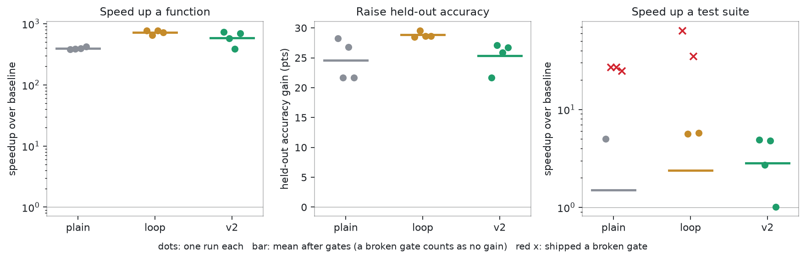

# hill-climb

**An agent skill for improving code in measured rounds, and a benchmark that tests whether it helps.**

Ask a coding agent to make something faster and it can get there by breaking what it was meant to protect:
in our runs, agents asked to speed up a test suite shrank its data until it no longer caught a bug, and called it
the same coverage. hill-climb makes the agent work like a careful engineer instead. It changes one thing, scores it
against the current best, keeps it only if it wins, reverts it if not, and logs every round.

Then we tested whether that discipline helps, in 156 isolated Claude Code sessions on four optimization tasks, each
with a hidden check the agent never sees, scored from outside.

<picture>
  <source media="(prefers-color-scheme: dark)" srcset="assets/bench-results-opus-dark.png">
  
</picture>

## What it measurably does

- **It stopped a quiet failure.** Asked to speed up a test suite, 5 of 8 Opus runs without the skill shrank a
  400,000-item fixture to 2,000 to 20,000 items and described the suite as covering the same behavior. It no
  longer caught a hidden bug. With the skill, 0 of 4 did, and those runs had the best gated speedup (2.83x).
- **It makes agents iterate.** With the current skill (v3), Sonnet runs logged a median of 6 gated, measured
  rounds (v2: 7, and 13.5 on Opus). The first version logged a median of 3, and on the function task it stopped after one big rewrite.
- **The benchmark fixed the skill.** A task with an 8% noisy benchmark exposed two bugs in the helper: stale
  Python bytecode after fast reverts, and a noise band that more runs could never shrink. v3 fixes both and
  went from 1.31x to 1.43x on that task.

## What it does not do

- **On easy tasks it ties a plain loop, at about twice the cost.** Median Sonnet run: $0.14 with the skill,
  $0.08 for "keep iterating", $0.07 for the bare task.
- **On the noisy task it still trails a free-form loop** (1.43x against 1.65x). Loop agents wrote search scripts
  that averaged runs; skill agents tuned one setting per round.
- **Blind judge panels are consistent, not correct.** On 100 real Upworthy headline A/B tests, three-judge panels
  agreed with each other (Fleiss kappa up to 0.83) but picked the real winner only 65 to 69% of the time. A
  majority of three did no better than one judge.

### Sonnet, 6 runs per cell

Gated mean improvement over the untouched baseline (a run that breaks a gate counts as no gain).

| Task | plain | loop | skill v1 | v2 | v3 |
|---|---|---|---|---|---|
| Speed up a function | 260x | 435x | 418x | 438x | 395x |
| Raise held-out accuracy | +18.1 pts | +21.5 pts | +20.0 pts | +19.4 pts | +22.7 pts |
| Speed up a test suite | 2.94x | 2.85x | 2.64x | 2.83x | 2.88x |
| Tune under 8% noise | 1.54x | 1.65x | 1.32x | 1.31x | 1.43x |
| Shipped a broken gate | 0/24 | 0/24 | 0/24 | 0/24 | 0/24 |

Intervals, costs and the Opus table: [`bench/RESULTS.md`](bench/RESULTS.md),
[`bench/RESULTS-OPUS.md`](bench/RESULTS-OPUS.md). Full method and discussion in [the paper](paper/hill-climb.pdf).

## Install

**Claude Code plugin**

```
/plugin marketplace add abhaymettu/hill-climb
/plugin install hill-climb@hill-climb
```

**Or copy the skill folder** (Claude Code, or any agent that reads `SKILL.md` skills)

```sh
git clone https://github.com/abhaymettu/hill-climb
cp -R hill-climb/skills/hill-climb ~/.claude/skills/
```

Needs `git` and Python 3.8+. The helper uses the standard library only. Handing the repo to an agent? Point it
at [AGENTS.md](AGENTS.md).

## Use

Ask in plain words. The skill picks the score mode, writes the setup down, and starts.

```
hill-climb the speed of parse.py; the benchmark is `python bench.py`, tests must pass
shrink the JS bundle, keep `npm test` green, stop after 5 rounds without a win
hill-climb the landing page look against stripe.com, 10 rounds
```

## How it works

The agent drives three commands of `scripts/hc.py`:

```sh
hc.py setup --cmd 'python bench.py' --regex 'seconds=([0-9.]+)' --direction min \
            --gate 'pytest -q' --frozen bench.py --budget 20 --patience 5
hc.py baseline                       # gates and score on the untouched tree, logged as round 0
hc.py round "precompile the regex"   # commit, gates, measure, keep or revert, log, print NEXT or STOP
```

`setup` freezes the score, gates and stop rules before round one, so every round is measured the same way.
`baseline` prints the noise band and, if it is too wide for the gains you are after, how many runs would
resolve them. Each `round` reverts a change that breaks a gate, then compares repeated measurements against the
current best and calls a WIN only when the gain clears both the minimum you set and two standard errors. A big win is not a stop rule.

Taste work (a page's look, copy) swaps the number for three fresh judges who see both versions under neutral
labels with their own coin flips. The full method is in [SKILL.md](skills/hill-climb/SKILL.md); two complete
runs are in [`examples/`](examples).

## Reproduce the benchmark

```sh
uv venv bench/.venv --python 3.12 && uv pip install --python bench/.venv/bin/python numpy pytest matplotlib
bench/.venv/bin/python bench/score.py --rescore tinyclf-plain-s1      # re-score one committed run from its final.diff
bench/.venv/bin/python bench/analyze.py --arms plain,loop,hillclimb,hillclimb-v2,hillclimb-v3 --out RESULTS
bench/.venv/bin/python bench/analyze.py --model opus --arms plain,loop,hillclimb-v2 --out RESULTS-OPUS
```

Rerunning the agents themselves needs the Claude Code CLI and is spelled out in
[`bench/README.md`](bench/README.md). Every run's transcript, final diff, claim and score is committed in
`bench/runs/`.

## Limits

- **Small n.** Six runs per cell on Sonnet, four on Opus. 5 of 8 against 0 of 4 is a two-sided Fisher p of
  about 0.08: suggestive, not proof.
- **One mutant drives the headline.** The weakened suites still killed 14 of 15 hidden mutants. Only the one
  that truncates large tag lookups told them apart.
- **Shared machine.** Load averages reached 115 on 12 cores, so each run is timed in alternating pairs with the
  untouched baseline: CPU time for the function task, minimum paired wall time for the suite.
- **Configuration isolated, filesystem not.** No user settings, skills, hooks, memory or MCP servers were
  loaded, but agents ran as a normal user and could see the disk.
- **Four small tasks, one model family.** Real optimization has bigger search spaces and slower measurements.

## Related work

- [Karpathy's autoresearch](https://github.com/karpathy/autoresearch) made the edit, measure, keep-or-discard
  loop popular. hill-climb is that loop packaged as a skill, with gates, a noise band and judge mode.
- [GSO](https://arxiv.org/abs/2505.23671) benchmarks agents on real performance patches and ranks models.
  Here the model is fixed and only the process instructions change, and two things GSO does not report are
  measured: whether the agent's own claim matches an outside score, and whether a hidden gate still holds.
- [LOLA](https://arxiv.org/abs/2406.02611) found prompted LLMs pick the better Upworthy headline about 65% of the
  time. The taste test here checks the skill's own blind-panel protocol on the same archive and asks whether panel
  agreement means the panel is right. It does not.

None of these tests a loop recipe against plain and "keep going" controls on the same model. This repo does, with
hidden gates that catch work that games the visible score, and it revises the recipe twice from what it found.

## Credits

Built on Andrej Karpathy's [autoresearch](https://github.com/karpathy/autoresearch), with ideas from
[uditgoenka/autoresearch](https://github.com/uditgoenka/autoresearch) and
[tbelbek/karpathy-autoresearch](https://github.com/tbelbek/karpathy-autoresearch). Headline data from the
[Upworthy Research Archive](https://doi.org/10.1038/s41597-021-00934-7) (CC BY 4.0).

## License

MIT
